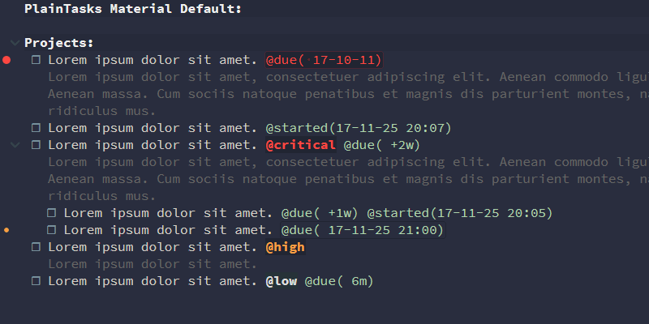
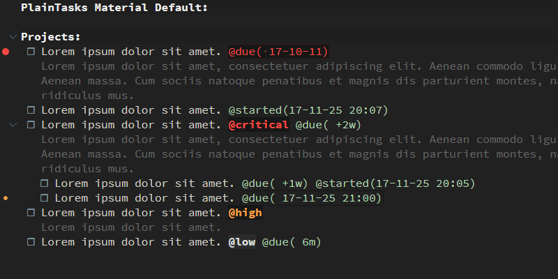
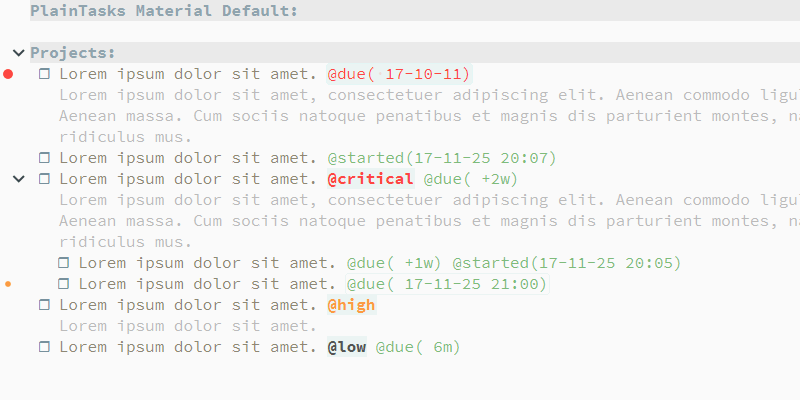

# PlainTasks Material Themes

A collection of [PlainTasks](https://github.com/aziz/PlainTasks) themes for [Sublime Text](https://www.sublimetext.com/) following the aesthetics of the excellent [Material Theme](https://github.com/SublimeText/material-theme/).

GitHub repo: <https://github.com/Gregory-K/PlainTasks-Material-Themes>.


> The [ao mindori](https://github.com/Gregory-K/ao-mindori/) theme could replace the no longer maintained Material Theme.

## Screenshots

**Material Default**  


**Material Palenight**  


**Material Darker**  


**Material Lighter**  



## Requirements

- Sublime Text 4
- [PlainTasks ST4 fork](https://github.com/Gregory-K/PlainTasks/), for **Sublime Text 4** (build 4213 or later) and Heading colours (H1-H4).
- '[ao mindori](https://github.com/Gregory-K/ao-mindori/)' theme (optional, for a matching UI)
- Material Theme (optional, for a matching UI -- no longer maintained)


## Install

- Open the Sublime Text Packages directory:  
`Ctrl+Shift+P` (win) `Cmd+Shift+P` (mac) > `Preferences: Browse Packages`
- Clone the repository there as `PlainTasks-Material-Theme`:  
```
git clone https://github.com/Gregory-K/PlainTasks-Material-Themes.git PlainTasks-Material-Theme
```

### Apply

Edit your PlainTasks settings and enter the path to your preferred theme.

```jsonc
{
  // Keep one uncommented:
  "color_scheme": "Packages/PlainTasks-Material-Theme/Themes/tasks-material-default.hidden-tmTheme",
  // "color_scheme": "Packages/PlainTasks-Material-Theme/Themes/tasks-material-darker.hidden-tmTheme",
  // "color_scheme": "Packages/PlainTasks-Material-Theme/Themes/tasks-material-lighter.hidden-tmTheme",
  // "color_scheme": "Packages/PlainTasks-Material-Theme/Themes/tasks-material-palenight.hidden-tmTheme",
}
```


## License

MIT License

Copyright (c) 2017-2026 Gregory.K

Based on the "tasks-eighties-dark" scheme from PlainTasks,
Copyright (c) 2012-2013 Allen Bargi, MIT License.

These files are under the MIT license.  
You can find the complete document here: [License.txt](License.txt).
